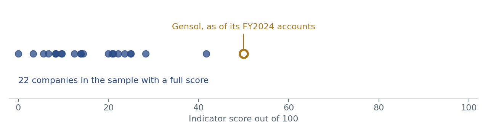
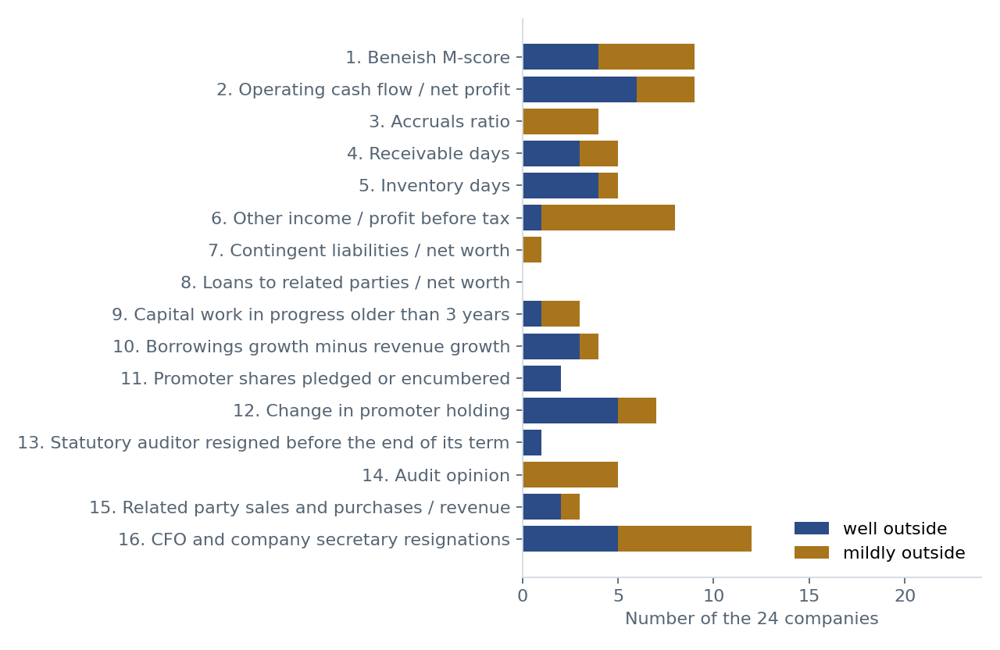

# market-study

This is an educational project. It runs sixteen accounting and governance checks over the public filings of listed Indian companies and turns them into plain indicator scores. It is not investment advice, I'm not registered with SEBI as a research analyst, and nothing here says any company or person has done anything wrong. A high score only means more of a company's numbers sit outside the ranges the checks treat as typical, and there are often ordinary business reasons for that.

You can look up every company, every check and the filing behind each number on the website, market-study-7mg.pages.dev. The full method, with every threshold, is in [scope&method.md](scope&method.md).

## What I did

I took the Nifty Smallcap 100 as NSE published it on 7 October 2026, dropped the financial companies and anything listed after March 2024, which left 64, and drew 24 of them at random within each industry using a fixed seed, so the same 24 come out every time. For each one I pulled five years of results from the XBRL files companies file with NSE, the shareholding patterns, the announcements about auditors and key managers, and the FY2026 annual report.

The checks cover three things. Earnings quality looks at the Beneish M-score, cash flow against profit, accruals, receivable and inventory days and other income. The balance sheet checks look at contingent liabilities, loans to related parties, old capital work in progress and borrowings growing faster than revenue. Governance looks at promoter pledging, falling promoter holding, auditor resignations, the audit opinion, related party trade and CFO or company secretary exits. Each check is within range, mildly outside or well outside, and the three group scores are averaged into one out of 100. I wrote the thresholds down before collecting any data.

## What came out

Of the 24, 22 had enough data for a full score. The middle score was about 14, eighteen companies were under 25, four were between 25 and 50, and none reached 50. Two companies have been on NSE for too short a time and are marked incomplete.

The check that came up most was CFO and company secretary resignations, with twelve companies having at least one in five years. Cash flow against profit and the M-score came next, at nine each, and then other income against profit before tax at eight. No company had loans to related parties anywhere near 10 percent of its net worth.

A lot of what the checks pick up has a plain explanation once you read the filings. A refinery that sells almost everything to its parent shows very high related party trade. A group with a lending arm shows weak operating cash flow because the loans it gives out count as operating outflows. Promoter holding falls when some family members are reclassified as public shareholders without anyone selling. And a merger or acquisition can make receivable or inventory days jump. The company pages say this wherever I found it.

## Checking it on a known case

To see if the checks respond to anything real, I ran them on Gensol Engineering, using its FY2024 annual report, the last full year of accounts before SEBI's interim order of April 2025. SEBI's orders record prima facie findings of falsified lender letters and diversion of company funds, with the investigation still going on at the time of its July 2025 order.

Gensol scores 50 as of those accounts, higher than any company in the live sample. Six checks were well outside their range, including the M-score, cash flow against profit, loans to related parties at about 35 percent of net worth, and 63 percent of promoter shares pledged. But the audit opinion was clean, nobody in key roles had left yet, and the M-score was pushed up a lot by revenue growing 2.4 times in a year. So it is one case that shows the checks can respond, not proof of how well they work. The details are in [validation/](validation/) and on the website.

## Limits

Twenty four companies is a small sample, and one validation case is very little. The FY2022 results files have no balance sheet, so the balance sheet checks start from FY2023. The annual report checks use only the FY2026 report. I found two cases where a company's own XBRL filing didn't hold together and left those figures out, which is written up in the method file. Some exits of key managers may only be mentioned inside board meeting outcomes, and I may have missed those.

## Files

universe.py picks the companies, financials.py and governance.py turn the NSE files into tables in data/clean, checks.py runs the checks and writes checks.csv and scores.csv, charts.py draws the two charts above and build_site.py builds the website in site/. The annual reports are not in the repo because of their size, but data/sources.md lists every source with its download date.

## Corrections

If any figure is wrong, please open an issue. I'll check it against the filing, fix it and log it in [corrections.md](corrections.md).
